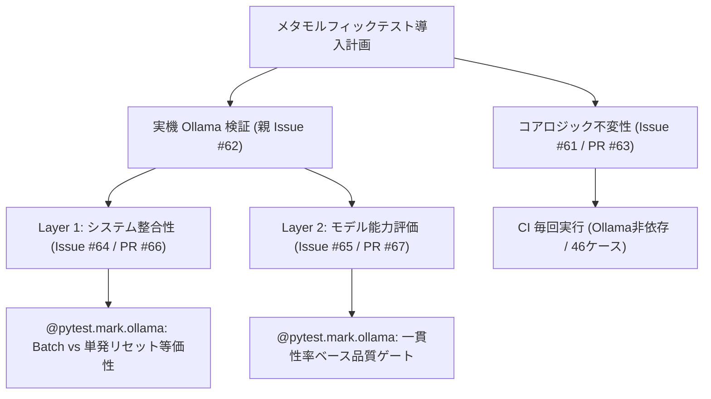

# メタモルフィックテスト導入・実機検証レビュー記録

- **対象 Issue / PR**:
  - コアロジック不変性: Issue [#61](https://github.com/xzyozi/jev-localsystem/issues/61) / PR [#63](https://github.com/xzyozi/jev-localsystem/pull/63)
  - 実機 Ollama 検証（親）: Issue [#62](https://github.com/xzyozi/jev-localsystem/issues/62)
  - Layer 1（システム整合性・KVキャッシュ等価性）: Issue [#64](https://github.com/xzyozi/jev-localsystem/issues/64) / PR [#66](https://github.com/xzyozi/jev-localsystem/pull/66)
  - Layer 2（モデル能力・適性評価）: Issue [#65](https://github.com/xzyozi/jev-localsystem/issues/65) / PR [#67](https://github.com/xzyozi/jev-localsystem/pull/67)
- **実施日**: 2026-11-14 〜 2026-11-15

---

## 1. レビュー背景とレイヤ切り分け方針

Zero-Decode 推論基盤の品質を「処理ロジックの数学的・構造的不変性」「システム挙動（KVキャッシュ再利用）の等価性」「LLM モデルの基礎能力差」に混同せず検証するため、メタモルフィックテストを 3 層に分離して設計・実施した。

### 切り分けの根拠

1. **コアロジック（#61）**: `ResultMapper`・`PromptBuilder`・`JudgePipeline`（モックバックエンド）が満たすべき対称性・単調性・順列不変性・State-First プレフィックス不変性は決定的であり、通常 CI に常設した。
2. **Layer 1（#64）**: KV キャッシュを保持した連続バッチ推論と、`keep_alive: 0` でアンロードした単発推論の結果一致は「同一モデル内のシステム整合性」であるため、モデル規模（Tier 1 / Tier 2）を問わず成立すべき条件として切り分けた。
3. **Layer 2（#65）**: 極性反転や 3 択以上の巡回置換・表記ゆれ/ノイズ耐性は LLM 本来の読解能力や位置バイアス耐性に依存するため、1 問単位のハードアサートではなく、一貫性率（Consistency Rate %）とマージン/信頼度変動量の計測スイートおよび品質ゲートとして設計した。

---

## 2. 各層の実装内容と実測レビュー結果

### 2.1 コアロジック不変性（Issue #61 / PR #63）

- **テスト**: `tests/test_metamorphic.py`（46 ケース、CI 対象、`0.09s` で全件 PASS）
- **検証項目**:
  - Noul: 確率入替の対称性、空白あり/なしトークンの配分比率不変性、共通対数確率シフト不変性
  - Choice: 2〜6 択順列不変性、共通定数加算不変性、`JudgePipeline(swap_verify=True)` の E2E 順列不変性
  - Score: 鏡像分布対称性（`E + E' == levels + 1`）、高評価シフト単調性、温度平滑化の中央値収束
  - Multi-Label: `offset` / `threshold` 単調性、入力ラベル順不変性
  - PromptBuilder: 同一 `context_text` に対する State-First プレフィックス完全一致

### 2.2 Layer 1: バッチ連続推論 vs 単発リセット推論の等価性（Issue #64 / PR #66）

- **検証スクリプト**: `scripts/verify_batch_cache_equivalence.py`
- **テスト**: `tests/test_batch_cache_equivalence.py`（`@pytest.mark.ollama`、4 ケース）
- **生データ・詳細ログ**:
  - `docs/logs/2026-11-14_batch_cache_equivalence_raw.json`
  - `docs/logs/2026-11-14_batch_cache_equivalence_verification.md`

| モデル | 対象スケール | 判定対象 API / メソッド | 判定一致 | 最大確率差 | スコア差 | 最大マージン差 |
| :--- | :--- | :--- | :--- | :--- | :--- | :--- |
| `qwen3:8b` | `short_1000c` | `/api/v1/evaluate` | True | `0.0` | `0.0` | `0.0` |
| `qwen3:8b` | `short_1000c` | `JudgePipeline.judge_multilabel` | True | `0.0` | - | `0.0` |
| `qwen3:8b` | `medium_3000c` | `/api/v1/evaluate` | True | `0.0` | `0.0` (`1.233`) | `0.0` |
| `qwen3:8b` | `medium_3000c` | `JudgePipeline.judge_multilabel` | True | `0.0` | - | `0.0` |
| `phi4-mini:latest` | `short_1000c` | `/api/v1/evaluate` | True | `0.0` | `0.0` (`3.434`) | `0.0` |
| `phi4-mini:latest` | `short_1000c` | `JudgePipeline.judge_multilabel` | True | `0.0023` | - | `0.011` |
| `phi4-mini:latest` | `medium_3000c` | `/api/v1/evaluate` | True | `0.0` | `0.0` (`3.468`) | `0.0` |
| `phi4-mini:latest` | `medium_3000c` | `JudgePipeline.judge_multilabel` | True | `0.0005` | - | `0.003` |

- **Pytest 実測**: `qwen3:8b` で 4/4 PASS（全体スイート内および単独実行 `319.79s` で確認）、`phi4-mini:latest` で 4/4 PASS（`189.70s`）。

### 2.3 Layer 2: モデル能力向けメタモルフィック評価（Issue #65 / PR #67）

- **評価スクリプト**: `scripts/verify_model_metamorphic.py`
- **テスト**: `tests/test_model_metamorphic.py`（`@pytest.mark.ollama`、3 ケース）
- **生データ・詳細ログ**:
  - `docs/logs/2026-11-14_model_metamorphic_raw.json`
  - `docs/logs/2026-11-14_model_metamorphic_verification.md`

| 評価軸 | 指標 | `qwen3:8b` (Tier 1) | `phi4-mini:latest` (Tier 2) |
| :--- | :--- | :--- | :--- |
| 極性反転（5 ペア） | `flip_consistency_rate` / `both_correct_rate` / `margin_sign_flip_rate` | `100.0%` / `100.0%` / `100.0%` | `100.0%` / `100.0%` / `100.0%` |
| 極性反転（分離マージン幅） | 肯定 / 否定マージン範囲 | `+13.7058 〜 +19.9909` / `-13.5834 〜 -19.9999` | `+3.0288 〜 +8.2305` / `-4.5005 〜 -9.4898` |
| Choice 巡回置換（4 問 / 14 シフト） | `cyclic_consistency_rate` / `correct_cyclic_rate` / `shift_accuracy_rate` | `100.0%` / `100.0%` / `100.0%` | `100.0%` / `100.0%` / `100.0%` |
| ノイズ耐性（4 問 / 12 変種） | `verdict_preservation_rate` | `100.0%` | `100.0%` |
| ノイズ耐性（変動量） | `max_confidence_delta` / `avg_confidence_delta` / `max_margin_delta` | `0.0` / `0.0` / `0.6931` | `0.002` / `0.00037` / `1.6819` |

- **Pytest 実測**: `qwen3:8b` で 3/3 PASS（`29.45s`）、`phi4-mini:latest` で 3/3 PASS（`14.07s`）。

---

## 3. 本番実装への影響と今後の技術的知見

### 3.1 本番コード変更の有無

- **`src/` 配下の本番コードは一切変更なし**: コアロジック・Layer 1・Layer 2 の全検証においてパイプライン実装や API 契約の不具合は検出されず、現行実装の妥当性を裏付けるテスト資産・実測ログの追加のみで完了した。
- **CI への影響**: 実機テスト（`tests/test_batch_cache_equivalence.py`, `tests/test_model_metamorphic.py`）には `@pytest.mark.ollama` を付与しており、通常 CI（`pytest -p no:cacheprovider -m "not ollama"`、153 passed / 21 deselected）からは安全に除外されている。

### 3.2 レビューで顕在化した設計上の観察点

1. **混合タスクバッチの Prefix Cache 境界**:
   - `/api/v1/evaluate` へ `choice` / `score` / `noul` / `multilabel` のように異なる `task_type` を混在投入すると、`PromptBuilder` が生成する `system_prompt` がタスク種別ごとに異なるため、異なるタスク間では Prefix Cache が共有されない（同一タスク種別の連続または `judge_multilabel` のラベル反復内でキャッシュが効く）。将来的なスループット最適化時には、`task_type` 単位での実行順序グルーピング等が検討対象になる。
2. **Tier 1 / Tier 2 モデルの信頼度余裕差**:
   - 明確な設問に対する一貫性率は両モデルとも 100.0% だったが、内部マージン幅およびノイズによるマージン変動量は `qwen3:8b` の方が大幅に安定していた。今後新モデルを Tier 1 候補として評価する際は、正答率だけでなく極性マージン幅とノイズ耐性変動量をベンチマーク指標として比較できる。
3. **高負荷直後のレイテンシ閾値テスト感度**:
   - `qwen3:8b` 向けの長文キャッシュ等価性テスト連続負荷（約 400 秒超）の直後に `tests/test_model_pipeline.py::test_token_binding_and_latency` を続けて実行した回では、単一 Forward レイテンシが `248.6ms` となり `200.0ms` 閾値を一時的に超過した（直後の単独再実行では `66.0ms` で通過）。実機連続実行時の環境揺らぎとして留意する必要がある。
